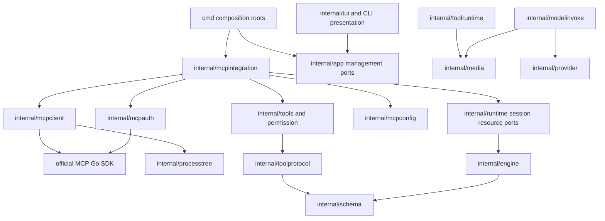

# Design Document: MCP Integration

**Related Spec**: [spec.md](spec.md)
**Confirmed Requirements**: [requirements.md](requirements.md)
**Created**: 2026-10-04
**Status**: Reviewed — PASS (review-design.md)

## Context

This design implements external MCP tools across the seven runtime profiles, including shared parent/child browser sessions, OAuth, configuration management, rich results, and actual model-visible screenshots. The authoritative product decisions are the 21 confirmed entries in requirements.md. Implementation details are delegated by DEC-009; this document resolves them without changing the confirmed behavior.

Verified repository facts:

- `internal/runtime/runtime_harness.go` supplies `HarnessDependencies.NewTools` per run. `AgentSession` in `session_lifecycle.go` owns multi-run admission and close but currently has no external connection resource hook.
- `internal/runtime/profile.go` intersects run restrictions with static profile tool ceilings. `child_runner.go` and `internal/childruntime/runner.go` apply additional child and read-only ceilings. Registering tools alone cannot make them usable.
- `internal/tools/registry.go` owns concrete definitions, dispatch, and optional `ResultTool`; `permission.DecorateRegistry` wraps dispatch with existing approval behavior. `registryexec` and `toolruntime` preserve separate full/model/observer text forms.
- `internal/schema/message.go`, `toolprotocol.ExecutionResult`, and `engine.ToolExecutionResult` carry strings. `engine/target.go` commits result text into a `schema.Message`; message cloning, runtime projection, persistence, compaction, and provider encoding must be extended together.
- `internal/provider/openai.go` uses Chat Completions, whose existing tool message encoding is textual. `internal/provider/claude.go` emits Anthropic tool-result blocks. Both are existing adapters, not new providers.
- `internal/processtree` provides platform process-tree containment. `Tree.Release` explicitly permits detached survivors; MCP ownership therefore uses `Tree.Close` and process reaping.
- CLI/remote/benchmark/autodev composition roots and the child runner register concrete tools separately. TUI code reaches application DTOs rather than concrete runtime infrastructure.

## Architecture & Components

New packages below are proposed implementation paths, not claims that they already exist. Existing packages retain their responsibilities.



Runtime consumes its own ports; it does not import any concrete MCP package. Engine continues importing only schema and its existing standard-library dependencies. Concrete integration is wired at existing composition roots. Dependency documentation and architecture tests change in the same implementation unit as new import edges; the immutable refactor fixture baseline and historical allowlist are not rewritten.

### C01 — Scoped server configuration (`internal/mcpconfig`)

- **Responsibility**: Parse/validate user and project MCP configuration, resolve whole-server precedence, preserve source scope, and atomically update the explicitly selected scope.
- **Interface**: `Load(homeDir, workDir) -> Catalog`, `Resolve(Catalog) -> Snapshot`, and scope-specific add/remove/enable/disable operations. Immutable snapshots contain resolved executable/endpoints, environment/header references, enablement, and limits.
- **Failure contract**: A malformed server entry is represented as an unavailable definition with an identifiable error; other entries remain usable. A syntactically unreadable scope is reported and not guessed or silently treated as a valid empty file. Management cannot overwrite an unreadable file without an explicit corrective edit. A missing file is an empty scope.
- **Covers**: REQ-003, REQ-004, REQ-005, REQ-006, REQ-015.

### C02 — Credentials and login (`internal/mcpauth`)

- **Responsibility**: Resolve static secret references, perform explicit OAuth authorization, persist and refresh credentials, and provide noninteractive token sources to normal runs.
- **Interface**: `Login(ctx, definition, browserPrompt)`, `Logout(ctx, credentialKey)`, `TokenSource(ctx, definition)`, and an injectable credential store. Login owns a bounded loopback callback listener and browser authorization URL; normal tool execution cannot invoke interactive login.
- **Issuer binding**: A preregistered confidential client must configure `auth.client_id`, `auth.client_secret_env`, and `auth.issuer`. Validate the issuer URL and compare it with discovered authorization-server metadata before requesting authorization or transmitting the secret. Include configured issuer in credential identity. Explicit login succeeds only after credentials have been obtained and persisted.
- **Storage contract**: `~/.foxharness/mcp-credentials.json`, directory mode 0700 and file mode 0600, same-directory temporary file and atomic replacement. A per-file lock serializes CLI/TUI updates; a per-credential lock serializes refresh. Keys bind effective endpoint, issuer/client identity, and configuration scope/project identity, not merely a display name. OAuth registration metadata, tokens, and refresh configuration are user-local. Sensitive values are redacted from status, errors, transcripts, and logs.
- **Covers**: REQ-007, REQ-008, REQ-009, NFR-004.

### C03 — MCP protocol client (`internal/mcpclient`)

- **Responsibility**: Adapt the pinned SDK into a narrow transport-independent client with discovery, call, linked-resource read, and close operations.
- **Interface**: `Connect(ctx, Definition, AuthSource) -> Session`; `Session.ListTools`, `CallTool`, `ReadResource`, `Close`, and immutable negotiated metadata. Paginated tool discovery is complete before the resulting catalog is published.
- **Transport contract**: Use SDK `IOTransport` over Fox-owned subprocess pipes, `StreamableClientTransport`, and `SSEClientTransport`. Fox owns process start/reaping through `processtree`, rather than delegating process ownership to `CommandTransport`. HTTP credentials and bounded response/event decoding apply to both transports. Automatic fallback between HTTP variants happens only during connection negotiation, not during tool-call retries.
- **Covers**: REQ-001, REQ-002, REQ-007, REQ-014, REQ-015, REQ-016, REQ-018, REQ-024.

### C04 — Session integration (`internal/mcpintegration` and runtime-owned ports)

- **Responsibility**: Bind resolved server definitions and live connections to an `AgentSession`, expose definitions/status and registry adapters, serialize per-server operations, and own reconnect and cleanup.
- **Runtime port**: Add an optional consumer-owned `SessionServices` interface and factory to `HarnessDependencies`. The service exposes an immutable external capability catalog, an explicit reconnect operation, and bounded close. The factory runs for both newly created and reopened live sessions. Construction errors must release the live-session lease and close partially created resources. A service with per-server failures remains a valid object with status records.
- **Admission contract**: Before `Profile.Resolve`, use the service's frozen catalog to derive a profile copy with an external tool extension; never mutate global profile definitions. The run receives one immutable union of built-in and permitted external capabilities before applying the existing run/skill/child intersections. Preserve nil versus explicitly empty restrictions. Only host-registered external names may extend a profile; arbitrary names in `RunSpec.AllowedTools` cannot create capabilities.
- **Child contract**: The concrete child runner receives a borrowed view of the parent's admitted service and catalog. It may narrow but cannot reconnect, close, or broaden them. Parent permission/capability lineage remains frozen; actual registry adapters use the child's permission coordinator, not a captured parent grant. Child-local result artifacts are persisted in the child's own session store.
- **Close contract**: Runtime closes owned services after run admission has stopped and active runs have finished, under a fresh bounded cleanup context. Borrowed child views have a no-op owner close. Cleanup errors are returned and observable; ordinary child completion/cancellation does not tear down the root connection.
- **Covers**: REQ-006, REQ-010, REQ-011, REQ-012, REQ-013, REQ-014, REQ-015, REQ-016, NFR-001, NFR-002, NFR-003.

### C05 — External tool and resource adapters (`internal/mcpintegration/tools.go`)

- **Responsibility**: Implement `tools.BaseTool`, `tools.ResultTool`, and `tools.PermissionAssessor` over C03/C04 without bypassing the registry's permission decorators.
- **Identity contract**: Map each `(server name, remote tool name)` to a bounded provider-safe name with a readable prefix and a digest suffix. Keep the exact origin tuple in the adapter. Reject a catalog collision rather than silently replacing a built-in or another external tool. The callable schema and executable adapter come from one catalog snapshot.
- **Permission contract**: External operations have unknown/external effects unless Fox has an independent trusted assessment. Server-provided read-only annotations are informational and cannot create a fast-allow path. Existing full-access/no-human profile policies remain as they are; interactive and remote approval profiles use their existing coordinator. Read-only children do not receive unknown-effect external operations, preserving their existing enforced ceiling. Writable, otherwise-authorized children can perform the browser handoff.
- **Resource contract**: Expose a bounded per-server resource-read helper only for tool-returned links already present in the active session. Each link records the source tool and origin session. The helper requires that the caller is still permitted to use the originating capability and separately authorizes the read. It cannot enumerate arbitrary resources, change server origin, fetch a local file URI directly, or become a resource-browsing surface. Read through the originating MCP connection.
- **Covers**: REQ-001, REQ-010, REQ-011, REQ-012, REQ-017, REQ-018, REQ-022.

### C06 — Rich result values and durable image artifacts (existing schema/result path plus `internal/media`)

- **Responsibility**: Carry supported content beyond strings, preserve correlation and errors, store validated image artifacts, and load them for model projection and replay.
- **Data contract**: Preserve all existing text fields and JSON encodings. Add optional `content_parts` and `structured_content` fields with `omitempty` to schema messages and results; expose matching values through toolprotocol and engine result contracts. Parts describe text, image artifact reference/media type, embedded resource content, or resource link. Incoming image bytes are transient until persisted and never placed into ordinary text previews.
- **Artifact contract**: `internal/media` writes content-addressed files beneath the owning stored session's `media/` directory. References use host-created relative keys and content hashes, never arbitrary server filesystem paths. Validate MIME, image decode/header, size, and root confinement before storing/loading. Persist artifacts before committing message references. Old JSON lacking new fields remains valid. Missing/corrupt referenced artifacts produce an explicit unavailable-image notice while usable textual history survives.
- **Pipeline contract**: Extend `ResultTool -> Registry -> registryexec -> toolruntime -> engine.ToolExecutionResult -> schema.Message -> runtime commit -> session JSONL`. Every defensive clone copies content slices and nested structured values. Text truncation affects text only; image payloads are stored separately. Observer/TUI/remote forms show a safe artifact reference and content summary, not base64.
- **Covers**: REQ-017, REQ-018, REQ-019, REQ-020, REQ-021, REQ-022, NFR-002, NFR-006.

### C07 — Model projection and image capabilities (existing modelinvoke/provider/compaction path)

- **Responsibility**: Resolve durable image references into transient request content, encode images for both provider families, and enforce explicit fallback.
- **Interface**: Inject a narrow artifact resolver into `modelinvoke`; the provider sees resolved schema content, not file-store operations. Add an optional `image_input` capability setting to LLM profiles with `auto`, `enabled`, and `disabled`. Old configurations default to `auto`; both existing adapters can encode images. Explicitly disabled models receive a limitation notice and text-only projection. Auto mode attempts image input; only a verified provider response that specifically rejects image input permits one same-model text-only fallback, with a visible notice. Generic errors do not trigger image stripping or model switching. Never rerun a screenshot tool to perform fallback.
- **Encoding contract**: Anthropic uses image blocks inside the correlated tool-result content. OpenAI Chat Completions retains all required tool-result messages, then adds the corresponding image parts in a synthetic user message after the complete consecutive tool-result batch. The synthetic message identifies originating call IDs and never interrupts an outstanding tool-call/result group. It is a transport projection, not a new persisted user request.
- **Context contract**: Preserve artifact references in durable history and retained conversation turns. Compaction can summarize earlier images under existing context rules; it must not destroy stored artifacts or imply later visual access when an image was not included. Count an explicit conservative image budget in context estimation rather than treating images as zero tokens. Rewind/replay preserves or removes message references according to existing sequence rules without deleting shared content-addressed files prematurely.
- **Covers**: REQ-019, REQ-020, REQ-021, NFR-001, NFR-002, NFR-006.

### C08 — Management application and presentation

- **Responsibility**: Provide one management service behind UI-neutral application ports, with CLI/TUI presentation and no direct TUI import of concrete MCP/runtime packages.
- **Paths**: New `internal/mcpcmd` for command-line parsing/presentation; `cmd/fox/mcp.go` for construction; `internal/app/mcp.go` for commands/status DTOs; `internal/tui/mcp.go` and slash dispatch wiring for `/mcp` management. Existing `internal/cli` remains the execution adapter and does not gain concrete infrastructure imports.
- **Status contract**: Distinguish disabled, connecting, ready, authorization-required, failed, and closed, with server/scope/transport, negotiated version, tool count, and redacted reason. Management status can probe ephemeral connections and closes them afterward; it never falsely reports another process's live connection state. Current-session TUI status refers to that session's actual service.
- **Covers**: REQ-005, REQ-006, REQ-008, REQ-009, REQ-014, REQ-015.

### C09 — Entry composition and acceptance

- **Responsibility**: Wire the same C04 integration into every existing root, preserve per-entry policy, and prove real browser/image behavior independently of ordinary tests.
- **Verified composition paths**: `cmd/fox/cli_runtime.go`, `cmd/fox/tui_runtime.go`, `cmd/fox/autodev_runtime.go`, `cmd/feishu/runtime_execution.go`, `cmd/agentops/runtime_execution.go`, `cmd/bench/main.go`, and `internal/childruntime/runner.go`.
- **Profile contract**: CLIExec and BenchmarkEval retain their existing no-coordinator policy; Autodev retains full-access/no-human behavior; TUI and remote entries preserve their coordinator and interaction mechanisms. MCP inclusion does not turn automatic memory extraction into an unrestricted tool client. Benchmark uses the case/session's resolved configuration, includes the chosen external capabilities in fidelity metadata, and cannot change the tool snapshot midway through a repeat.
- **Acceptance contract**: New hermetic fixtures under `internal/testsupport/mcpfixture`; separate opt-in integration tests under `internal/mcpintegration` and a documented command. The live test uses a controlled local page and pinned Playwright, with image input verified at the provider boundary. A separately configured live model demonstration verifies visual analysis; ordinary `go test ./...` needs neither external credentials nor a browser.
- **Covers**: REQ-010, REQ-023, REQ-024, NFR-001, NFR-002, NFR-005.

## Key Design Decisions

### DD01 — Pin the official SDK and isolate its APIs

- **Context**: Three transports, protocol negotiation, rich content, and OAuth are required; the repository currently has no MCP dependency.
- **Decision**: Pin `github.com/modelcontextprotocol/go-sdk v1.8.0` (Go 1.25.0 compatible) behind C03/C02. Verified SDK transports: `IOTransport`, `StreamableClientTransport`, `SSEClientTransport`. The SDK supports negotiation with 2026-07-28, 2025-11-25, 2025-06-18, 2025-03-26, and 2024-11-05; Fox's tests exercise the selected client behavior against each negotiated version while avoiding a claim to implement unrelated optional MCP capabilities. Verified transport-specific boundary: legacy SSE downgrades a 2026-07-28 request to 2025-11-25; the 2026-07-28 HTTP fixture uses the SDK's stateless mode.
- **Alternatives**: A custom JSON-RPC implementation increases lifecycle/protocol work; a second SDK would duplicate contracts.
- **Trade-off**: OAuth client APIs are documented as experimental; the pin, wrapper, and fixture tests contain that dependency risk. SDK transitive version changes require the repository regression suite.
- **Covers**: REQ-001, REQ-002, REQ-007, REQ-024.

### DD02 — Explicit transport plus bounded negotiation

- **Decision**: Configuration accepts `stdio`, `streamable-http`, `sse`, or `http` (automatic negotiation). `http` tries Streamable HTTP and uses the protocol-defined legacy fallback only for connection-negotiation responses that indicate the old transport. Authentication failures are not legacy-transport signals. Configure SDK reconnect retries conservatively and disallow tool-call POST replay after an ambiguous transport outcome. Stream/SSE reconnection is distinct from replaying a tool request.
- **Trade-off**: Explicit transport is available for endpoints whose behavior is ambiguous; failed connection affects only that server.
- **Covers**: REQ-002, REQ-014, REQ-015, REQ-016.

### DD03 — Dedicated MCP configuration, whole-definition override

- **Decision**: Use `~/.foxharness/mcp.json` and `<workDir>/.foxharness/mcp.json`, JSON object `mcpServers` keyed by server name. `workDir` is the entry's existing resolved workspace; do not silently traverse parents. Validate each chosen effective definition after whole-entry replacement. Missing `enabled` means enabled. Environment and header secrets can use named environment-variable references; project files store references, not OAuth token state. Runtime configuration snapshots remain unchanged until new-session/reconnect semantics apply.
- **Trade-off**: Dedicated files avoid coupling model/TUI settings parsing to external-server configuration; same-name replacement is predictable and does not merge hidden credentials.
- **Covers**: REQ-003, REQ-004, REQ-005, REQ-006, REQ-008.

### DD04 — Root-owned connections and serial dispatch

- **Decision**: One service per live root Fox session; child views borrow it. Connection creation uses a session-owned context, while startup has its own deadline; ending the first run does not cancel a multi-run session connection. Each server has an independently cancellable call queue of capacity one. Waiting consumes the call's deadline. Reconnect waits for active calls to finish or be cancelled, then swaps a complete generation; old captured adapters fail as stale rather than dispatch through a replacement generation.
- **Trade-off**: Serial per-server calls favor reliable browser state over throughput. Different sessions may still conflict if their external server configuration shares a browser profile; the controlled Playwright acceptance uses isolated profiles.
- **Covers**: REQ-006, REQ-012, REQ-013, REQ-014, REQ-016.

### DD05 — Extend capability ceilings without weakening them

- **Decision**: Host-resolved external capabilities extend profile ceilings before normal narrowing. Existing static-only resolver behavior is retained for callers without session services. Parent, child persona, explicit allowed-tools, and read-only intersections all apply to the same advertised/executable snapshot; empty remains deny-all. Unknown-effect MCP tools are unavailable in enforced read-only child execution, regardless of server annotations. An authorized writable child uses its parent's connection with child-local approval.
- **Trade-off**: This deliberately preserves the existing read-only constraint rather than treating tool annotations as a security guarantee. It does not prevent normal main-agent or writable-child Playwright workflows.
- **Covers**: REQ-010, REQ-011, REQ-012, NFR-002.

### DD06 — Additive rich content, artifact references in history

- **Decision**: Keep existing string fields intact and add optional rich-content fields. Persist binary images separately using verified references. Hydrate only model-bound copies; providers never read arbitrary server-returned paths. Apply actual image encoding and explicit fallback in C07, and keep synthetic provider messages out of durable conversation authority.
- **Trade-off**: This crosses several existing packages but avoids base64 inflation in history/previews and preserves old records. Image data is still available for deliberate replay after compaction.
- **Covers**: REQ-017, REQ-019, REQ-020, REQ-021, REQ-022, NFR-006.

### DD07 — OAuth login is explicit; refresh is reusable

- **Decision**: Use the SDK `auth.AuthorizationCodeHandler` for authorization-code/PKCE login and discovery, with a loopback callback. Support configured preregistered clients and dynamic registration as supported by the server; an optional client-ID metadata URL is accepted when configured, without requiring Fox to host a public metadata service. Use `InitialTokenSource` and `NewTokenSource` hooks to load/store tokens and refresh metadata. Normal sessions use a noninteractive wrapper: unresolved challenges return authorization-required. For SSE, an HTTP wrapper obtains/refreshes tokens from the same store; interactive login happens separately, never by replaying a side-effecting call after a transport error.
- **Logout contract**: Remove the local credential and invalidate local token sources; report local logout accurately without promising remote token revocation that the server does not support. Other configured authentication mechanisms are unaffected.
- **Trade-off**: User-local protected files provide cross-platform behavior without introducing a new keychain dependency. Authentication discovery, issuer/state/PKCE checks, credential scoping, and redirect handling use the verified SDK and bounded tests.
- **Covers**: REQ-007, REQ-008, REQ-009, REQ-016, NFR-004.

### DD08 — Bound memory and lifecycle without truncating protocol frames

- **Decision**: Default startup deadline 30 seconds, per-call deadline 120 seconds (queue wait included), login deadline 5 minutes, and shutdown budget 5 seconds with forceful owned-process-tree termination as necessary. Server definitions may configure positive startup/call values. Bound each inbound protocol frame/SSE event at 32 MiB and each decoded image at 20 MiB; cap retained diagnostic stderr at 64 KiB per server. Overflow is an explicit failure, not byte truncation into malformed JSON. Existing text preview/output policy remains in toolruntime; artifact/image limits are separate. Limits are implementation defaults, not performance guarantees.
- **Trade-off**: Oversized screenshots/results produce actionable limits rather than unbounded memory usage. The exact field names and documented defaults are defined below, and tests use shorter injected deadlines.
- **Covers**: REQ-014, REQ-015, REQ-017, REQ-022, NFR-003.

### DD09 — Stable ordinary tests and real browser acceptance

- **Decision**: Pin Playwright MCP `0.0.83` for the explicit live acceptance command; record its Node/browser prerequisites and dependency resolution. Ordinary tests use in-memory/loopback/subprocess fixture servers and scripted image-aware providers. Browser tests use an isolated context against a locally served deterministic page; no production website interaction is needed. Pin files and compatibility documentation record versions rather than fetching `latest` during tests.
- **Trade-off**: Real model interpretation is not deterministic; verify exact image requests in automated tests and retain a separately runnable live-model demonstration of the user workflow.
- **Covers**: REQ-023, REQ-024, NFR-005.

## Data Models and Interface Contracts

### Configuration contract

**Covers**: REQ-003, REQ-004, REQ-005, REQ-006, REQ-007, REQ-014.

```json
{
  "mcpServers": {
    "playwright": {
      "transport": "stdio",
      "command": "npx",
      "args": ["-y", "@playwright/mcp@0.0.83", "--headless", "--isolated"],
      "env": {},
      "env_from": {},
      "enabled": true,
      "startup_timeout_seconds": 30,
      "call_timeout_seconds": 120
    },
    "remote": {
      "transport": "http",
      "url": "https://example.invalid/mcp",
      "headers": {},
      "headers_from_env": {"Authorization": "EXAMPLE_AUTH_HEADER"},
      "auth": {"type": "headers"}
    }
  }
}
```

`env` contains literal non-secret launch values; `env_from` maps child environment names to variables read from Fox's environment. `headers_from_env` maps HTTP header names to source variables. `auth.type` is `none`, `headers`, `bearer`, or `oauth`; bearer uses `token_env` or a user-local credential reference. OAuth may configure client ID, user-local secret reference, scopes, redirect port, or client metadata URL. Static-header and OAuth authorization must not compete to set the same authorization header. A missing required secret reference makes that server unavailable with a redacted diagnostic. Credential values are never included in effective-configuration display.

### Management command contract

**Covers**: REQ-005, REQ-006, REQ-008, REQ-014, REQ-015.

| Command | Behavior |
|---|---|
| `fox mcp list` / `fox mcp status [name]` | Show resolved scope/configuration; status probes use temporary connections and say so |
| `fox mcp add NAME --scope user\|project --transport ...` | Add a definition; stdio command/args follow `--`; remote uses `--url` and credential references |
| `fox mcp remove NAME --scope ...` | Remove only the named definition in the selected scope |
| `fox mcp enable NAME --scope ...` / `disable` | Update the selected definition, with new-session/reconnect activation notice |
| `fox mcp login NAME` / `logout NAME` | Authenticate the effective definition or remove its user-local credential |
| `/mcp` in TUI | Show current-session status and expose equivalent scoped management actions |
| `/mcp reconnect NAME` in TUI | Drain active calls, close the selected connection, resolve/apply current configuration, and rediscover tools |

A standalone CLI command cannot reconnect an unrelated running process because Fox has no IPC management plane. CLI execution already creates a new live session using current configuration; the active-session reconnect operation is provided by the app management port/TUI. This distinction is displayed rather than hidden. Login prints an authorization URL even when opening a browser is unavailable, and cancellation closes its listener.

### Rich data and service ports

**Covers**: REQ-010–014, REQ-017–022, NFR-001, NFR-006.

| Proposed contract | Essential fields / semantics |
|---|---|
| `schema.ContentPart` | Type, text, MIME type, artifact reference, resource URI/name, optional embedded content; transient image bytes excluded from persistence |
| `schema.Message` additions | Optional content parts and structured content; existing Content/ToolCalls/ToolCallID encoding unchanged |
| `toolprotocol.ExecutionResult` additions | Rich parts and structured data alongside Output/Failed |
| `engine.ToolExecutionResult` additions | Model-bound rich parts alongside existing full/model/observer strings; engine remains infrastructure-independent |
| `runtime.ExternalCapability` | Exact host-generated name and trusted read-only classification, never a server-granted permission |
| `runtime.SessionServices` | Frozen catalog, explicit reconnect, bounded close; no concrete MCP SDK or registry types |
| `runtime.HarnessDependencies` addition | Optional service factory called for both CreateSession and OpenSession; default nil preserves existing behavior |
| `app.MCPManager` | UI-neutral list/status/edit/login/logout/reconnect operations and redacted status DTOs |
| `media.Store` | Persist/resolve validated image artifacts under the owning stored-session root |

## Sequence and Data Flow

**Covers**: REQ-001, REQ-006, REQ-010–022.

1. A composition root constructs scoped configuration, auth, protocol, and integration factories and injects the optional session-service port into the shared runtime.
2. Creating/opening a live root session resolves one catalog and connects enabled servers under bounded startup work. Per-server failures become status entries. A child session instead receives a borrowed parent service.
3. Run admission derives the external capability ceiling, intersects existing restrictions, and freezes the same effective set for prompt/tool discovery and execution. Registry adapters are decorated with the caller's policy.
4. A model tool call is authorized before queueing/dispatch. The per-server queue serializes it under the call deadline. Cancellation reaches the protocol request; uncertain side effects are reported without replay.
5. The result adapter converts content; toolruntime persists images before returning rich results to engine. Engine commits a correlated schema message through runtime's existing authority. Text previews and artifact references go to observers.
6. Before model invocation, modelinvoke resolves image references on a copy and provider translates it into native image blocks. Unsupported-model fallback uses the same model, a visible limitation notice, and text projection, never another tool execution.
7. Explicit reconnect drains active calls, swaps the affected generation/configuration, and refreshes catalog state before the next run. Session close drains ownership and closes the process tree/connections. Child completion only releases the borrowed view.

## Cross-Cutting Design

**Covers**: REQ-009, REQ-011, REQ-014–022, NFR-001–006.

- Permissions and source identity are preserved through alias/name mapping, resource helpers, reconnect generations, and child intersections. Nonconfigured external names remain uncallable. Read-only restrictions do not rely on remote self-description.
- Runtime close/admission stays authoritative. The MCP host cannot persist conversation state or decide run outcomes; it supplies explicit results and cleanup errors through existing boundaries.
- Secret/header values and binary image bytes are excluded from diagnostic strings. Stored configuration/credential mutation uses locking and atomic replacement; malformed files are not silently overwritten.
- Structured content and image references are deep-copied anywhere existing messages/results are cloned. Schema-only additions preserve engine's import boundary; media resolution stays outside it.
- Existing compaction, rewind, autosummary, checkpoint, and remote delivery behavior remains unchanged for text-only sessions. Image artifacts are not garbage-collected as a side effect of truncating a projected context; ordinary session deletion remains their lifetime boundary.
- MCP server and browser prerequisites belong to the user-managed external environment. Fox status identifies launch failures; the acceptance workflow documents installation rather than assuming it happened.

## Risks and Trade-offs

| Risk | Impact | Treatment |
|---|---|---|
| SDK OAuth is experimental | Upstream API/behavior drift | Pin SDK; isolate adapter; hermetic refresh/discovery/login tests |
| Image support crosses existing string-only paths | Images silently disappear or break provider message ordering | Full pipeline scenarios, deep-copy tests, artifact replay, both provider request tests |
| Remote tools claim read-only behavior | Child or approval bypass | Claims are informational; retain enforced unknown-effect restrictions |
| OAuth/SSE reconnect may resend requests | Duplicate external side effects | Distinguish handshake/stream recovery from tool-call replay; transport fault tests |
| Shared browser context | Interleaving or incorrect cleanup | Per-server serial calls, borrowed child views, root-only close |
| A remote service shares global state | Independent Fox sessions may still interact | Explicit boundary and isolated Playwright acceptance configuration |

## Evidence and Resolved Deferrals

The official SDK source was inspected in the Go module cache at `github.com/modelcontextprotocol/go-sdk@v1.8.0`; no project dependency was changed during design. `go list -m -json` reports Go 1.25.0 compatibility. Verified source symbols include `auth.AuthorizationCodeHandlerConfig.InitialTokenSource`, `NewTokenSource`, `AuthorizationCodeFetcher`, the three transport types, and `ClientSession.ListTools/CallTool/ReadResource`. The package registry reports Playwright MCP 0.0.83 and Node >=18. Sources: [SDK v1.8.0](https://github.com/modelcontextprotocol/go-sdk/tree/v1.8.0), [MCP transports](https://modelcontextprotocol.io/specification/2025-11-25/basic/transports), [Playwright MCP](https://github.com/microsoft/playwright-mcp).

OPEN-001 is resolved by C02/DD07; OPEN-002 by C01/DD03 and management contracts; OPEN-003 by C04/DD04/DD05/DD08; OPEN-004 by C06/C07/DD06; OPEN-005 by DD01/DD09 and the component layout. Upstream open entries remain historical delegated items; this document records their technical resolution. No new product decision is asserted.

## Requirements Coverage

| Spec requirement | Design coverage |
|---|---|
| REQ-001 | C03, C05, DD01; call sequence |
| REQ-002 | C03, DD01, DD02 |
| REQ-003 | C01, DD03; configuration contract |
| REQ-004 | C01, DD03 |
| REQ-005 | C01, C08; management contract |
| REQ-006 | C04, DD03, DD04; reconnect generation |
| REQ-007 | C02, C03, DD07 |
| REQ-008 | C02, C08, DD07 |
| REQ-009 | C02, C08, DD07 |
| REQ-010 | C04, C05, C09, DD05 |
| REQ-011 | C04, C05, DD05 |
| REQ-012 | C04, C05, DD04, DD05 |
| REQ-013 | C04, DD04 |
| REQ-014 | C03, C04, C08, DD08 |
| REQ-015 | C01, C03, C04, C08 |
| REQ-016 | C03, C04, DD02, DD04, DD07 |
| REQ-017 | C05, C06, DD06, DD08 |
| REQ-018 | C03, C05, C06 |
| REQ-019 | C06, C07, DD06 |
| REQ-020 | C06, C07, DD06 |
| REQ-021 | C06, C07, DD06 |
| REQ-022 | C05, C06, DD08 |
| REQ-023 | C09, DD09 |
| REQ-024 | C03, C09, DD01, DD09 |
| NFR-001 | Architecture graph, C04, C07, C09 |
| NFR-002 | C04, C06, C07, C09, DD05 |
| NFR-003 | C04, DD08 |
| NFR-004 | C02, DD07 |
| NFR-005 | C09, DD09 |
| NFR-006 | C06, C07, DD06 |
